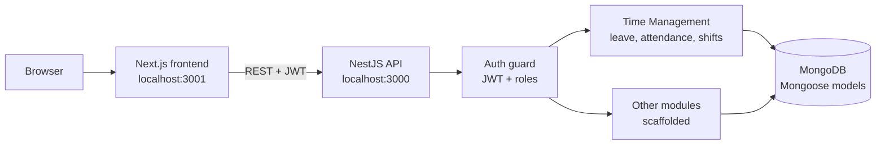

<div align="center">

# HR Time Management System

**A full-stack HR platform (NestJS + Next.js) built as one subsystem of a larger team application.**
The Time Management and authentication parts are the finished core; the rest of the HR scope is scaffolded and labeled as such.


[](LICENSE)

</div>

## At a glance

| | |
|---|---|
| **Finished** | Time Management: leave requests, attendance, shift tracking, with DTOs, controllers and services (CRUD). Authentication: JWT via Passport.js, role-based access, bcrypt password hashing |
| **Scaffolded, not complete** | Employee Profiles, Organization Structure, Recruitment, Payroll (configuration, execution, tracking), Performance |
| **Stack** | NestJS + Mongoose (backend), Next.js + React + Tailwind + Radix UI (frontend) |
| **Run it** | Node 18+, local MongoDB, [five commands](#running-it-locally) |
| **Source of truth for status** | [`backend/MISSING_IMPLEMENTATIONS_REPORT.md`](backend/MISSING_IMPLEMENTATIONS_REPORT.md) |

This README separates what works from what is only planned, on purpose. The feature list in [`PROJECT_DOCUMENTATION.md`](PROJECT_DOCUMENTATION.md) describes the platform's *intended* scope, not its current status.

## Contents

[Architecture](#architecture) · [What is built and what is not](#what-is-built-and-what-is-not) · [Running it locally](#running-it-locally) · [Repository layout](#repository-layout) · [Known limitations](#known-limitations) · [Stack](#stack)

## Architecture



## What is built and what is not

| Module | Status |
|---|---|
| Authentication (JWT, Passport.js, roles, bcrypt) | Built |
| Time Management (leave requests, attendance, shifts) | Built: DTOs, controller, service, CRUD endpoints |
| Employee Profiles, Organization Structure, Recruitment, Payroll, Performance | Data models and partial scaffolding; missing DTOs, controllers or service logic in places |

The project's own [`MISSING_IMPLEMENTATIONS_REPORT.md`](backend/MISSING_IMPLEMENTATIONS_REPORT.md) tracks the gaps module by module. It was written during development and may lag the code, so treat it and the source together.

## Running it locally

Needs Node 18+ and a local MongoDB.

```bash
# backend (http://localhost:3000)
cd backend
cp .env.example .env          # set JWT_SECRET
npm ci
npm run seed:auth             # optional demo users; deletes existing employee_profiles / employee_system_roles
npm run start:dev

# frontend (http://localhost:3001), in a second terminal
cd frontend
cp .env.example .env.local
npm ci
npm run dev
```

`nest build` completes cleanly on the backend. The `seed:auth` demo accounts all use the password `123456`, so only use them on a local database. Details and every environment variable are in [`PROJECT_DOCUMENTATION.md`](PROJECT_DOCUMENTATION.md) and the two `.env.example` files.

## Repository layout

```text
.
├── backend/                  # NestJS API
│   └── src/
│       ├── auth/             # JWT strategies, guards, decorators
│       ├── time-management/  # the finished module
│       ├── leaves/ employee-profile/ organization-structure/
│       ├── recruitment/ payroll-*/ performance/   # scaffolded
│       └── seeds/            # demo data
├── frontend/                 # Next.js app
├── PROJECT_DOCUMENTATION.md  # architecture, API, schema, setup
└── backend/MISSING_IMPLEMENTATIONS_REPORT.md
```

## Known limitations

- Several modules are scaffolded only (see above).
- The JWT strategies fall back to a hard-coded secret when `JWT_SECRET` is unset. Always set it outside local development.
- Some frontend pages hard-code `http://localhost:3000` / `5000` as the API fallback instead of reading one shared setting; setting `NEXT_PUBLIC_API_URL` in `.env.local` covers it.
- No CI is configured for this repository.

## Stack

- **Backend:** NestJS, MongoDB via Mongoose, Passport.js + JWT, class-validator
- **Frontend:** Next.js, React, Tailwind CSS, Radix UI

See [`PROJECT_DOCUMENTATION.md`](PROJECT_DOCUMENTATION.md) for full architecture, API endpoints, database models, and setup instructions.

## License

[MIT](LICENSE) © 2026 Abdelrahman Shaheen
